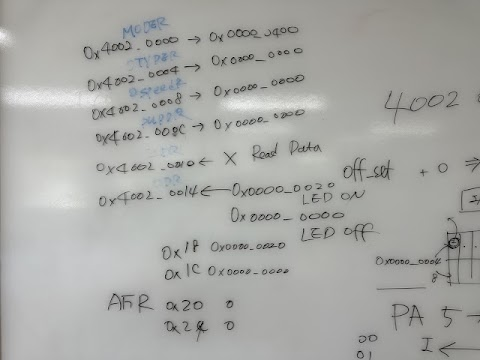
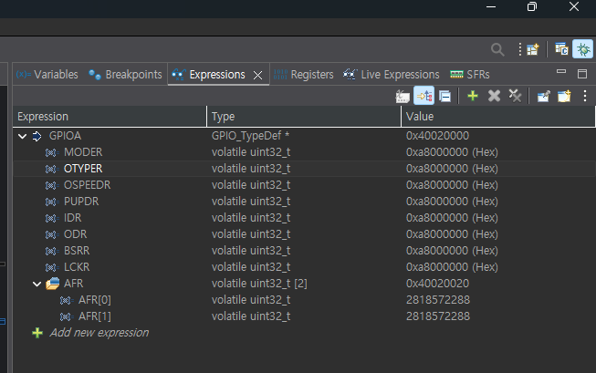
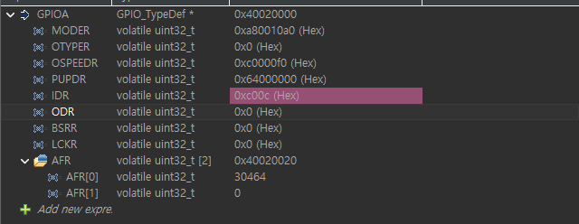

# 01. GPIO

NUCLEO-F411RE 보드에서 GPIO 레지스터를 디버거로 직접 확인하고 조작해 본 내용 정리

- 참고 문서
  - Datasheet : STM32F411xC/xE (DS10314)
  - Reference Manual : RM0383 (레지스터 비트 설명)
  - Board : UM1724 (NUCLEO 보드 회로 / LED 연결)

---

## 1. GPIOA 레지스터 맵

GPIOA Base Address : `0x4002_0000`

| Offset | 주소 | 레지스터 | 역할 |
|---|---|---|---|
| 0x00 | 0x4002_0000 | MODER | 핀 모드 (입력 / 출력 / AF / 아날로그) |
| 0x04 | 0x4002_0004 | OTYPER | 출력 타입 (Push-Pull / Open-Drain) |
| 0x08 | 0x4002_0008 | OSPEEDR | 출력 속도 |
| 0x0C | 0x4002_000C | PUPDR | Pull-up / Pull-down |
| 0x10 | 0x4002_0010 | IDR | 입력 데이터 (Read Only) |
| 0x14 | 0x4002_0014 | ODR | 출력 데이터 |
| 0x18 | 0x4002_0018 | BSRR | 비트 Set / Reset |
| 0x1C | 0x4002_001C | LCKR | 설정 잠금 |
| 0x20 | 0x4002_0020 | AFR[0] (AFRL) | Alternate Function (핀 0~7) |
| 0x24 | 0x4002_0024 | AFR[1] (AFRH) | Alternate Function (핀 8~15) |



---

## 2. 기본 LED 토글 코드

```c
  /* USER CODE BEGIN 2 */
  int counter = 0;
  /* USER CODE END 2 */

  while (1)
  {
    counter++;
    HAL_GPIO_TogglePin(LD2_GPIO_Port, LD2_Pin);
    HAL_Delay(1000);
  }
```

`LD2_GPIO_Port`, `LD2_Pin` 은 `main.h` 에 정의된 매크로일 뿐이다.

```c
#define LD2_Pin        GPIO_PIN_5
#define LD2_GPIO_Port  GPIOA
```

따라서 아래 두 줄은 같은 코드

```c
HAL_GPIO_TogglePin(LD2_GPIO_Port, LD2_Pin);
HAL_GPIO_TogglePin(GPIOA, GPIO_PIN_5);
```

---

## 3. 디버거로 레지스터 확인

### 3-1. 처음 결과 : 모든 값이 `0xA8000000` ?



- 디버그를 시작하면 `main()` 첫 줄에서 멈춰 있다 → `MX_GPIO_Init()` **실행 전**
- `0xA8000000` 은 GPIOA MODER의 **리셋값** (PA13, PA14, PA15 = SWD 디버그 핀)
- 모든 레지스터가 같은 값으로 보인 것은 Expressions 창 표시 문제 → **SFRs 창** 또는 **Memory 창**(`0x40020000`)으로 확인하는 것이 정확

### 3-2. 해결 : F8 (Resume)

`HAL_Delay(1000);` 줄에 브레이크포인트 → **F8** 로 실행하면 GPIO 초기화 후 값이 보인다.

| 키 | 동작 |
|---|---|
| F8 | Resume : 다음 브레이크포인트까지 실행 |
| F6 | Step Over : 한 줄 실행 (함수 안으로 안 들어감) |
| F5 | Step Into : 함수 안으로 들어감 |

### 3-3. 리셋값 vs 실행 후 기대값 (PA5 출력)

| 레지스터 | GPIOA 리셋값 | 실행 후 |
|---|---|---|
| MODER | `0xA800_0000` | `0xA800_0400` |
| OTYPER | `0x0000_0000` | `0x0000_0000` |
| OSPEEDR | `0x0C00_0000` | `0x0C00_0000` |
| PUPDR | `0x6400_0000` | `0x6400_0000` |
| ODR | `0x0000_0000` | `0x0000_0020` ↔ `0x0000_0000` (1초마다 토글) |

> 칠판의 `0x0000_0400` 은 **PA5 비트만** 적은 값. 실제로는 디버그 핀(PA13~15) 설정 때문에 상위 비트 `0xA8` 이 붙어 `0xA800_0400` 이 정상.

---

## 4. MODER / ODR 비트 계산

MODER 는 **핀 하나당 2비트** 사용 → 핀 n 은 비트 `[2n+1 : 2n]`

| 값 | 모드 |
|---|---|
| 00 | Input |
| 01 | General purpose Output |
| 10 | Alternate Function |
| 11 | Analog |

ODR 은 **핀 하나당 1비트** → 핀 n 은 비트 n

| 핀 | MODER 비트 | 출력 설정값 | ODR ON 값 |
|---|---|---|---|
| PA5 | [11:10] | `0x0000_0400` | `0x0000_0020` |
| PA6 | [13:12] | `0x0000_1000` | `0x0000_0040` |

```
PA6 MODER : 01 << (6 × 2) = 1 << 12 = 0x1000
PA6 ODR   : 1 << 6               = 0x40
```

---

## 5. 실습 : PA6 으로 바꾸기

디버거에서 MODER / ODR 값을 직접 수정



| 레지스터 | 값 | 해석 |
|---|---|---|
| MODER | `0xA800_10A0` | `0x1000` : PA6 출력 / `0x00A0` : PA2, PA3 AF (USART2) / `0xA800_0000` : SWD |
| OSPEEDR | `0x0C00_00F0` | PA2, PA3 Very High Speed (UART) |
| IDR | `0x0000_C00C` | PA2, PA3 (UART Idle = High), PA14, PA15 (SWD) |
| ODR | `0x0` / `0x40` | PA6 Low / High |
| AFR[0] | 30464 = `0x7700` | PA2, PA3 = AF7 (USART2) |

- ODR 을 `0x40` / `0x0` 으로 바꾸면 **오실로스코프에서 PA6 신호가 잡힌다**
- 하지만 **보드 LED 는 안 켜진다**

### 왜 LED 가 안 켜질까?

NUCLEO-F411RE 의 LD2 는 PCB 상에서 **PA5 (D13) 에만** 연결되어 있다.

```
PA5 ──[저항]──▶|── GND    ← LD2 (보드 LED)
PA6 ──────────── D12 핀만 나와 있음 (LED 없음)
```

- PA6 : 출력 정상 → 오실로스코프 OK
- PA5 : MODER 에서 출력 설정이 빠져 입력 모드 → LD2 꺼짐

PA6 으로 LED 를 보려면 외부 LED 연결

```
D12(PA6) ──[220Ω~1kΩ]──▶|── GND
```

> 디버거에서 수정한 값은 임시. 리셋하거나 다시 다운로드하면 코드대로 돌아간다.

---

## 6. 코드로 PA6 출력 설정

### 방법 1 : CubeMX (.ioc)

PA6 클릭 → `GPIO_Output` 설정 → 코드 재생성

### 방법 2 : 레지스터 직접

```c
  /* USER CODE BEGIN 2 */
  GPIOA->MODER &= ~(3U << 12);   // PA6 MODER 비트 클리어
  GPIOA->MODER |=  (1U << 12);   // PA6 = 출력 (01)
  /* USER CODE END 2 */

  while (1)
  {
    GPIOA->ODR ^= (1U << 6);     // PA6 토글 (0x40)
    HAL_Delay(1000);
  }
```

### 방법 3 : HAL 함수

```c
HAL_GPIO_TogglePin(GPIOA, GPIO_PIN_6);
```

> HAL 함수도 MODER 설정(방법 1 또는 2)은 따로 필요. MODER 가 입력 모드면 ODR 이 바뀌어도 핀으로 출력되지 않는다.
>
> `main.h` 의 `#define LD2_Pin` 을 직접 고치면 CubeMX 코드 재생성 시 덮어써지므로 비추천.

---

## 7. BSRR (Offset 0x18)

`HAL_GPIO_WritePin` 은 ODR 이 아니라 **BSRR** 에 쓴다.

| 동작 | BSRR 값 (PA5) | 결과 |
|---|---|---|
| Set (ON) | `1 << 5` = `0x0000_0020` | ODR bit5 = 1 |
| Reset (OFF) | `1 << (5+16)` = `0x0020_0000` | ODR bit5 = 0 |

- ODR 수정 : 읽기 → 수정 → 쓰기 (3단계, 중간에 인터럽트가 끼면 다른 핀 값이 깨질 수 있음)
- BSRR : **한 번 쓰기**로 끝 (원자적 동작)

```c
GPIOA->BSRR = (1U << 5);         // PA5 ON
HAL_Delay(1000);
GPIOA->BSRR = (1U << (5 + 16));  // PA5 OFF
HAL_Delay(1000);
```
