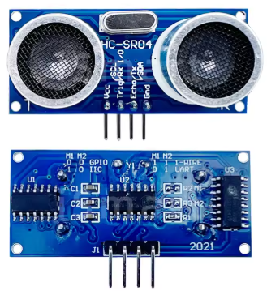
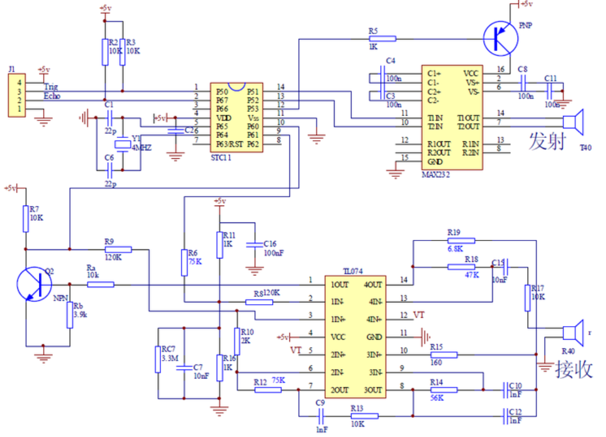
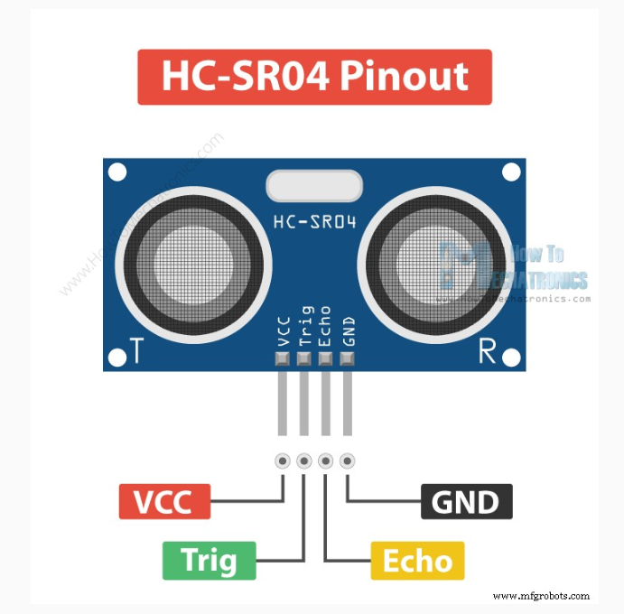
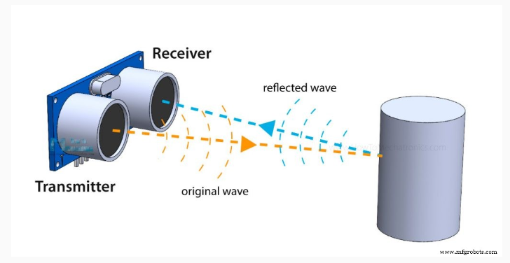
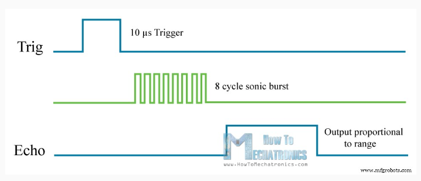
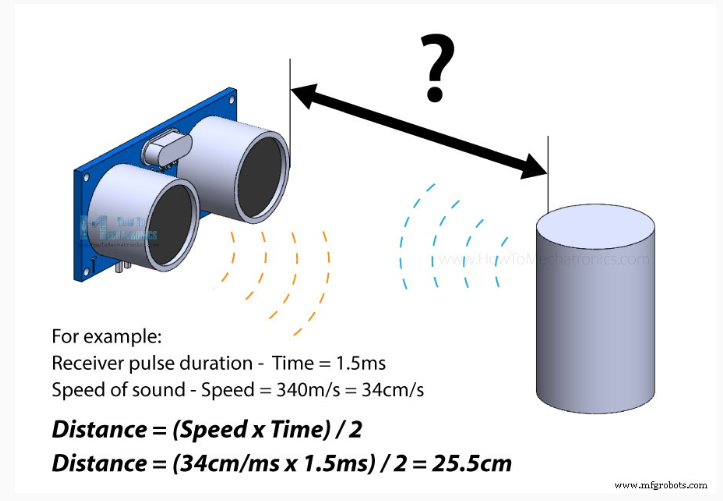
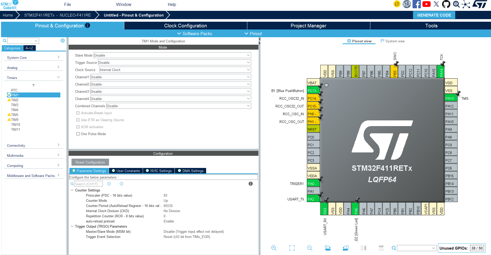
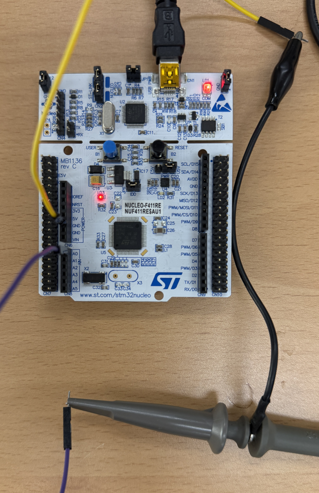
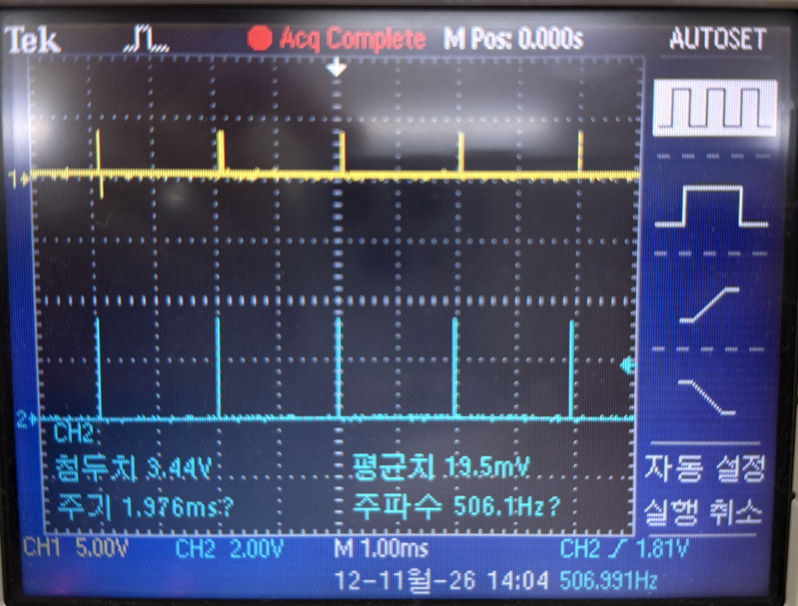

# 02. HC-SR04 (초음파 센서)

NUCLEO-F411RE 로 HC-SR04 초음파 센서의 TRIG 신호를 만들고 오실로스코프로 확인한 내용 정리

- 수업 자료 : [gotree94/STM32 06.HC-SR04 (NUCLEO-F103RB)](https://github.com/gotree94/STM32/tree/main/NUCLEO_F103RB/06.HC-SR04)
  - 수업 자료는 F103RB 기준 → 여기서는 **F411RE** 에 맞춰 설정

## Table of Contents
- [1. HC-SR04 센서](#1-hc-sr04-센서)
- [2. 동작 원리](#2-동작-원리)
- [3. CubeMX 설정](#3-cubemx-설정)
- [4. 코드](#4-코드)
- [5. 실습 : TRIG 신호 측정](#5-실습--trig-신호-측정)

---

## 1. HC-SR04 센서

 



| 핀 | 역할 |
|---|---|
| VCC | 전원 5 V |
| Trig | 측정 시작 신호 입력 (MCU → 센서) |
| Echo | 거리에 비례하는 펄스 출력 (센서 → MCU) |
| GND | 접지 |

---

## 2. 동작 원리

 

1. MCU 가 **Trig 에 10 µs HIGH 펄스**를 준다
2. 센서가 40 kHz 초음파를 8번(8 cycle sonic burst) 쏜다
3. 반사파가 돌아올 때까지 **Echo 가 HIGH** 를 유지 → Echo HIGH 시간 = 왕복 시간



```
음속 ≈ 340 m/s = 0.34 mm/µs
거리 = 음속 × 시간 / 2  (왕복이므로 ÷2)
     = 0.34 × t(µs) / 2 = 0.17 × t(µs)  [mm]
```

코드에서는 정수 계산을 위해 `dist = 17 * echo_time / 100;` (mm)

---

## 3. CubeMX 설정



| 항목 | 설정 | 의미 |
|---|---|---|
| PA0 | GPIO_Output, Label `TRIGER1` | Trig 출력 핀 |
| PA2 / PA3 | USART2 TX / RX | printf 출력용 |
| TIM1 Clock Source | Internal Clock | |
| TIM1 Prescaler | **83** | 84 MHz / (83+1) = **1 MHz** → 1 count = **1 µs** |
| TIM1 Counter Period | 65535 | 최대 65.535 ms 까지 카운트 |

> 시스템 클럭 : HSI 16 MHz → PLL (M=16, N=336, P=4) → **84 MHz**, APB2 분주 1 → TIM1 클럭 84 MHz

---

## 4. 코드

### 4.1 µs 딜레이와 TRIG 펄스

```c
/* USER CODE BEGIN PD */
#define HIGH 1
#define LOW 0
long unsigned int echo_time;
int dist;
/* USER CODE END PD */

/* USER CODE BEGIN 0 */
void timer_start(void)
{
   HAL_TIM_Base_Start(&htim1);
}

void delay_us(uint16_t us)
{
   __HAL_TIM_SET_COUNTER(&htim1, 0);              // 카운터 0 부터 시작
   while((__HAL_TIM_GET_COUNTER(&htim1)) < us);   // 1 count = 1 µs
}

void trig(void)
{
   HAL_GPIO_WritePin(TRIGER1_GPIO_Port, TRIGER1_Pin, HIGH);
   delay_us(10);                                  // 10 µs HIGH
   HAL_GPIO_WritePin(TRIGER1_GPIO_Port, TRIGER1_Pin, LOW);
}
/* USER CODE END 0 */
```

### 4.2 main

```c
  /* USER CODE BEGIN 2 */
  timer_start();
  /* USER CODE END 2 */

  while (1)
  {
    trig();
    HAL_Delay(1);
  }
```

---

## 5. 실습 : TRIG 신호 측정

### 5.1 보드 연결



| 선 | 보드 쪽 | 오실로스코프 쪽 |
|---|---|---|
| 보라색 | CN7 **PA0 (TRIGER1)** | 프로브 팁 |
| 노란색 | CN6 **GND** | 프로브 접지 집게 |

### 5.2 오실로스코프 측정 결과



| 측정값 (CH2) | 값 |
|---|---|
| 첨두치 | 3.44 V |
| 주기 | 1.976 ms |
| 주파수 | 506.1 Hz |

- 시간축 1 ms/div 에서 10 µs 펄스는 너무 짧아 **세로선(스파이크)** 처럼 보임
- 펄스 높이 약 3.3 V → PA0 HIGH 출력 확인
- 주기 약 2 ms = `trig()` (10 µs) + `HAL_Delay(1)`
  - `HAL_Delay(1)` 은 최소 대기 시간을 보장하려고 1 tick 을 더 기다려서 실제로는 약 2 ms
