# 02. HC-SR04 (초음파 센서)

NUCLEO-F411RE 로 HC-SR04 초음파 센서의 TRIG 신호를 만들고 오실로스코프로 확인한 내용 정리

- 수업 자료 : [gotree94/STM32 06.HC-SR04 (NUCLEO-F103RB)](https://github.com/gotree94/STM32/tree/main/NUCLEO_F103RB/06.HC-SR04)
  - 수업 자료는 F103RB 기준 → 여기서는 **F411RE** 에 맞춰 설정

## Table of Contents
- [1. HC-SR04 센서](#1-hc-sr04-센서)
- [2. 동작 원리](#2-동작-원리)
- [3. CubeMX 설정](#3-cubemx-설정)
- [4. 코드](#4-코드)
- [5. 실습 : TRIG 신호 측정](#5-실습--trig-신호-측정)
- [6. 실습 : 초음파 센서 연결 후 ECHO 측정](#6-실습--초음파-센서-연결-후-echo-측정)
- [7. 실습 : 거리 측정 (PuTTY 출력)](#7-실습--거리-측정-putty-출력)
- [8. 실습 : EXTI + 상태 머신 거리 측정 (STEP02)](#8-실습--exti--상태-머신-거리-측정-step02)
- [9. 실습 : STEP02 거리측정2 (TIM1 + 중앙값 + 디버그 출력)](#9-실습--step02-거리측정2-tim1--중앙값--디버그-출력)

---

## 1. HC-SR04 센서

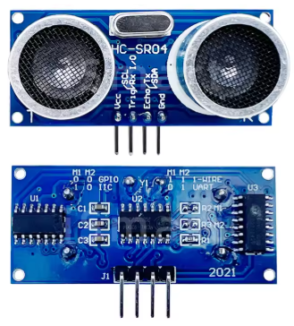 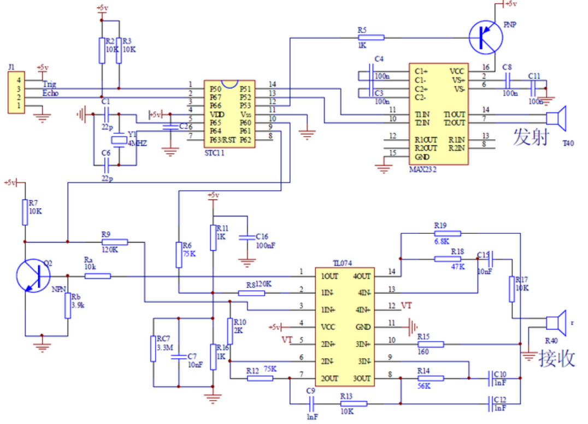

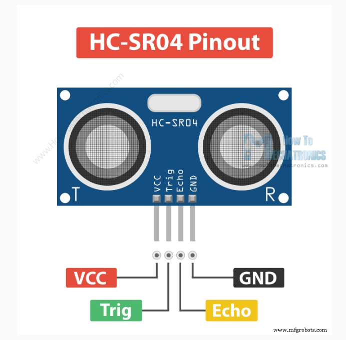

| 핀 | 역할 |
|---|---|
| VCC | 전원 3.3 V |
| Trig | 측정 시작 신호 입력 (MCU → 센서) |
| Echo | 거리에 비례하는 펄스 출력 (센서 → MCU) |
| GND | 접지 |

---

## 2. 동작 원리

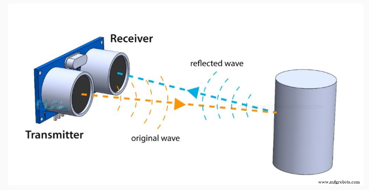 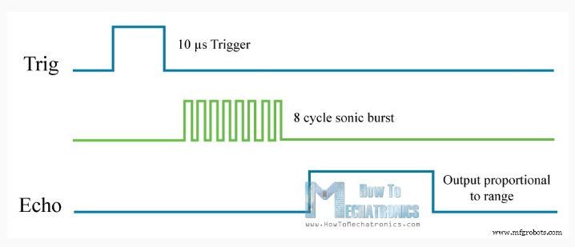

1. MCU 가 **Trig 에 10 µs HIGH 펄스**를 준다
2. 센서가 40 kHz 초음파를 8번(8 cycle sonic burst) 쏜다
3. 반사파가 돌아올 때까지 **Echo 가 HIGH** 를 유지 → Echo HIGH 시간 = 왕복 시간

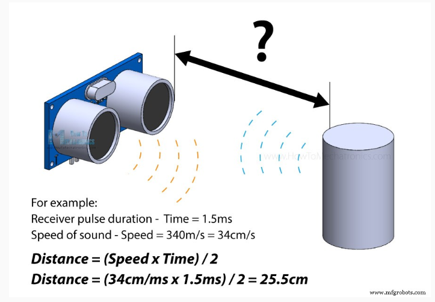

```
음속 ≈ 340 m/s = 0.34 mm/µs
거리 = 음속 × 시간 / 2  (왕복이므로 ÷2)
     = 0.34 × t(µs) / 2 = 0.17 × t(µs)  [mm]
```

코드에서는 정수 계산을 위해 `dist = 17 * echo_time / 100;` (mm)

---

## 3. CubeMX 설정

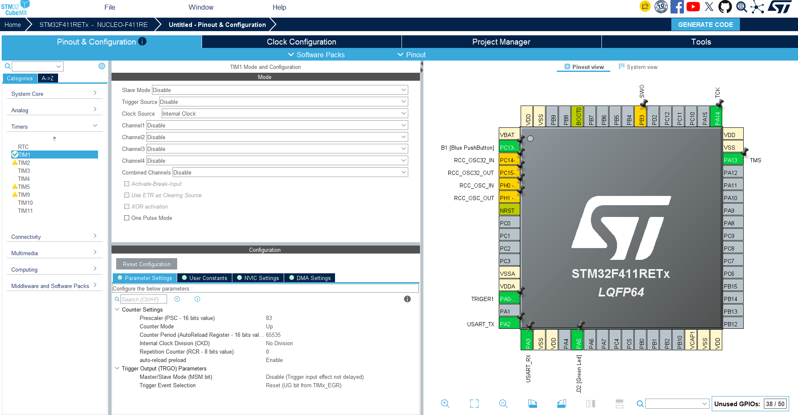

| 항목 | 설정 | 의미 |
|---|---|---|
| PA0 | GPIO_Output, Label `TRIGER1` | Trig 출력 핀 |
| PA1 | GPIO_Input, Label `ECHO1` | Echo 입력 핀 |
| PA2 / PA3 | USART2 TX / RX | printf 출력용 |
| TIM1 Clock Source | Internal Clock | |
| TIM1 Prescaler | **83** | 84 MHz / (83+1) = **1 MHz** → 1 count = **1 µs** |
| TIM1 Counter Period | 65535 | 최대 65.535 ms 까지 카운트 |

> 시스템 클럭 : HSI 16 MHz → PLL (M=16, N=336, P=4) → **84 MHz**, APB2 분주 1 → TIM1 클럭 84 MHz

---

## 4. 코드

### 4.1 µs 딜레이와 TRIG 펄스

```c
/* USER CODE BEGIN PD */
#define HIGH 1
#define LOW 0
long unsigned int echo_time;
int dist;
/* USER CODE END PD */

/* USER CODE BEGIN 0 */
void timer_start(void)
{
   HAL_TIM_Base_Start(&htim1);
}

void delay_us(uint16_t us)
{
   __HAL_TIM_SET_COUNTER(&htim1, 0);              // 카운터 0 부터 시작
   while((__HAL_TIM_GET_COUNTER(&htim1)) < us);   // 1 count = 1 µs
}

void trig(void)
{
   HAL_GPIO_WritePin(TRIGER1_GPIO_Port, TRIGER1_Pin, HIGH);
   delay_us(10);                                  // 10 µs HIGH
   HAL_GPIO_WritePin(TRIGER1_GPIO_Port, TRIGER1_Pin, LOW);
}
/* USER CODE END 0 */
```

### 4.2 main

```c
  /* USER CODE BEGIN 2 */
  timer_start();
  /* USER CODE END 2 */

  while (1)
  {
    trig();
    HAL_Delay(1);
  }
```

---

## 5. 실습 : TRIG 신호 측정

### 5.1 보드 연결

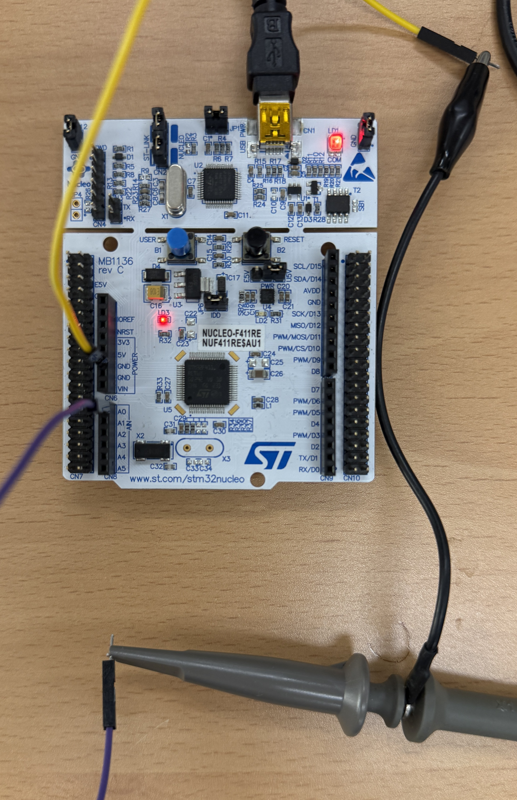

| 선 | 보드 쪽 | 오실로스코프 쪽 |
|---|---|---|
| 보라색 | CN7 **PA0 (TRIGER1)** | 프로브 팁 |
| 노란색 | CN6 **GND** | 프로브 접지 집게 |

### 5.2 오실로스코프 측정 결과

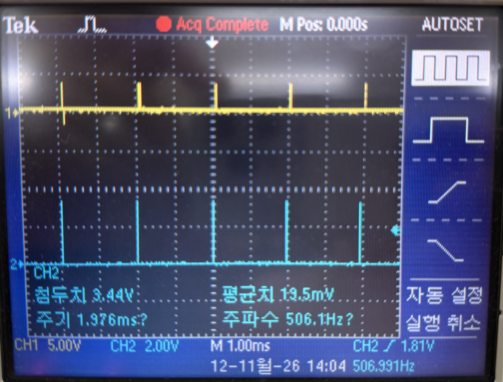


- 시간축 1 ms/div 에서 10 µs 펄스는 너무 짧아 **세로선(스파이크)** 처럼 보임
- 펄스 높이 약 3.3 V → PA0 HIGH 출력 확인
- 주기 약 2 ms = `trig()` (10 µs) + `HAL_Delay(1)`
  - `HAL_Delay(1)` 은 최소 대기 시간을 보장하려고 1 tick 을 더 기다려서 실제로는 약 2 ms

### 5.3 딜레이 200 으로 변경

```c
  while (1)
  {
    trig();
    HAL_Delay(200);
  }
```

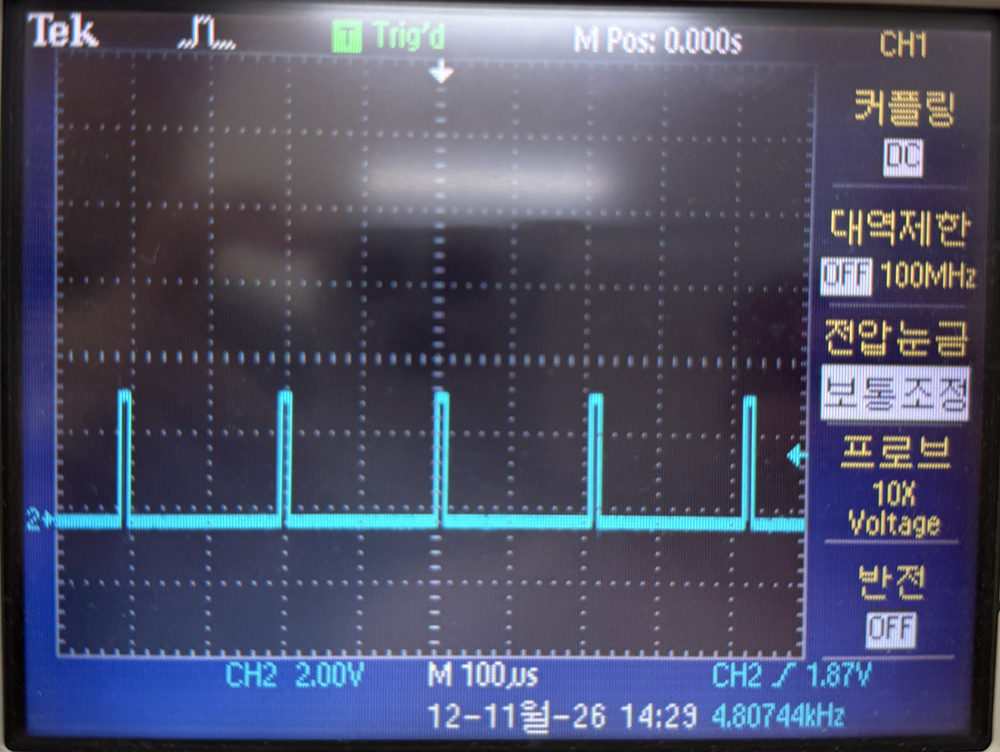

- `HAL_Delay(1)` → `HAL_Delay(200)` 으로 바꾸니 TRIG 파형이 **더 정확하게** 측정됨
- 시간축 100 µs/div 에서 스파이크가 아니라 **폭이 있는 10 µs 펄스** 모양으로 보임
- 펄스 높이 약 3.3 V (CH2 2 V/div)

---

## 6. 실습 : 초음파 센서 연결 후 ECHO 측정

### 6.1 코드 수정

```c
  while (1)
  {
    trig();
    //HAL_Delay(200);
    delay_us(200);
  }
```

- `HAL_Delay(200)` 대신 `delay_us(200)` 으로 TRIG 를 빠르게 반복

### 6.2 센서 연결

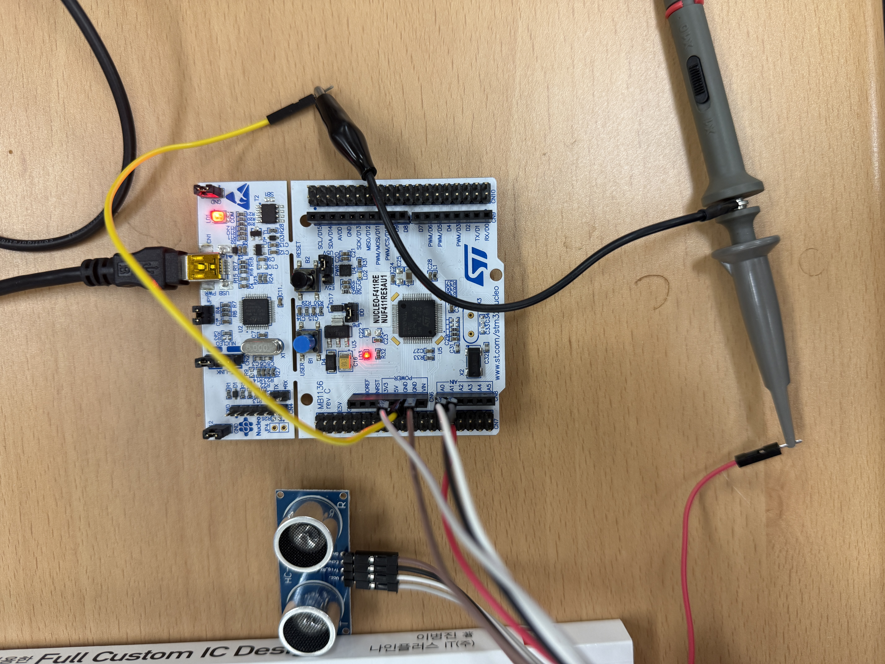

| 센서 핀 | 보드 쪽 |
|---|---|
| VCC | **3.3 V** |
| GND | **GND** |
| Trig | **A0 (PA0, TRIGER1)** |
| Echo | **A1 (PA1)** + 오실로스코프 프로브에 같이 연결 |

- ECHO 신호를 오실로스코프로 측정

### 6.3 거리에 따른 ECHO 파형

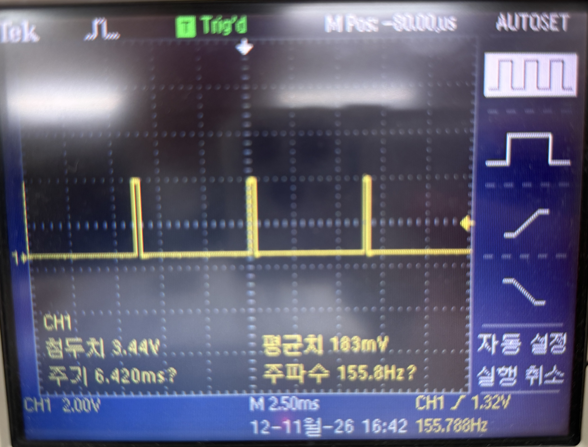 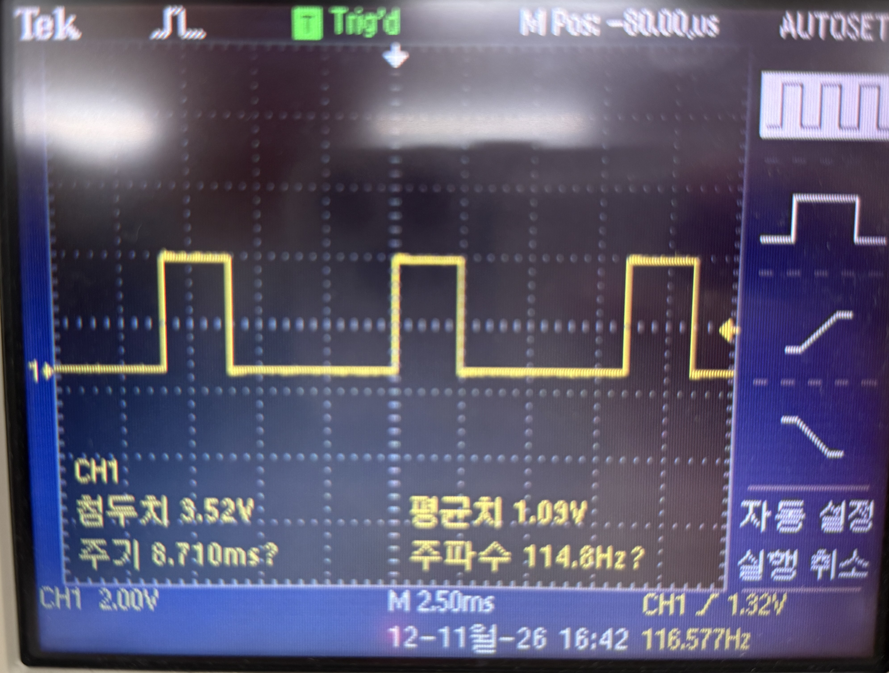

| 왼쪽 : 가까울 때 | 오른쪽 : 멀 때 |
|---|---|
| ECHO HIGH 폭이 **짧다** | ECHO HIGH 폭이 **길다** |

- 물체가 멀수록 초음파 왕복 시간이 길어져 ECHO HIGH 폭이 길어짐 → 거리에 따른 차이를 눈으로 확인

---

## 7. 실습 : 거리 측정 (PuTTY 출력)

### 7.1 CubeMX 설정

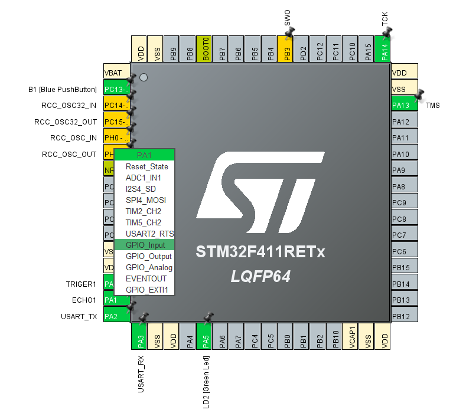

- PA1 → GPIO_Input, Label `ECHO1`

### 7.2 코드

```c
/* USER CODE BEGIN Includes */
#include <stdio.h>
/* USER CODE END Includes */
```

```c
/* USER CODE BEGIN 0 */
#ifdef __GNUC__
#define PUTCHAR_PROTOTYPE int __io_putchar(int ch)
#else
#define PUTCHAR_PROTOTYPE int fputc(int ch, FILE *f)
#endif /* __GNUC__ */

PUTCHAR_PROTOTYPE
{
  if (ch == '\n')
    HAL_UART_Transmit (&huart2, (uint8_t*) "\r", 1, 0xFFFF);
  HAL_UART_Transmit (&huart2, (uint8_t*) &ch, 1, 0xFFFF);

  return ch;
}

uint32_t echo(void) {
    uint32_t start_tick, start_time, end_time;

    // ECHO HIGH 대기 (최대 10ms)
    start_tick = HAL_GetTick();
    while (HAL_GPIO_ReadPin(ECHO1_GPIO_Port, ECHO1_Pin) == GPIO_PIN_RESET) {
        if ((HAL_GetTick() - start_tick) > 10) return 0;
    }
    start_time = __HAL_TIM_GET_COUNTER(&htim1);

    // ECHO LOW 대기 (최대 30ms)
    start_tick = HAL_GetTick();
    while (HAL_GPIO_ReadPin(ECHO1_GPIO_Port, ECHO1_Pin) == GPIO_PIN_SET) {
        if ((HAL_GetTick() - start_tick) > 30) return 0;
    }
    end_time = __HAL_TIM_GET_COUNTER(&htim1);

    return end_time - start_time;
}
/* USER CODE END 0 */
```

```c
  /* USER CODE BEGIN 2 */
  timer_start();
  printf("Ranging with HC-SR04\n");
  /* USER CODE END 2 */

  while (1)
  {
    trig();
    echo_time = echo();
    if (echo_time != 0) {
        dist = (int)(17 * echo_time / 100);
        printf("Distance = %d(mm)\n", dist);
    }
    else printf("Out of Range!\n");
    HAL_Delay(250);
  }
```

### 7.3 PuTTY 측정 결과

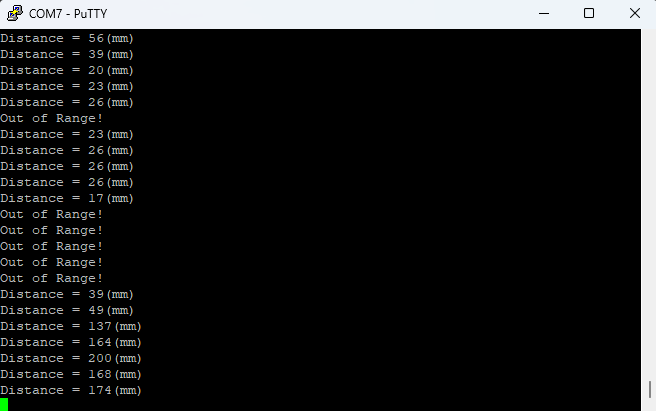

- 물체와의 거리에 따라 측정값이 바뀌며 정상적으로 동작하는 것을 확인

---

## 8. 실습 : EXTI + 상태 머신 거리 측정 (STEP02)

7번의 폴링 방식(`while` 로 ECHO 대기 + `HAL_Delay`)을 **EXTI 인터럽트 + 비차단 상태 머신** 방식으로 바꾸고, 출력을 CSV 형식으로 확인한 내용 정리

- 수업 자료 : [gotree94/STM32 STEP02_거리측정 (NUCLEO-F411RE)](https://github.com/gotree94/STM32/blob/main/NUCLEO_F411RE/00.F411_TASK_LAB/STEP02_%EA%B1%B0%EB%A6%AC%EC%B8%A1%EC%A0%95.md)

### 8.1 7번과 달라진 점

| 항목 | 7번 (폴링) | 8번 (STEP02) |
|---|---|---|
| 타이머 | TIM1 (16비트) | **TIM2** (32비트, 1 tick = 1 µs) |
| ECHO 측정 | `while` 로 HIGH / LOW 될 때까지 대기 | **EXTI 양쪽 에지 인터럽트**로 시각만 기록 |
| 측정 주기 | `HAL_Delay(250)` | 200 ms 마다 1회 (5 Hz), `HAL_Delay` 없음 |
| 출력 | `Distance = ...(mm)` | 1초마다 최근 5개 **중앙값** CSV |
| TRIG / ECHO 핀 | PA0 / PA1 | **PA1 / PA0** (선 바꿔 연결) |

- ISR 에서는 **시각 기록만** → 거리 계산 / 필터 / 출력은 메인 루프에서 처리
- 측정 중에도 CPU 가 대기하지 않음 → 다른 작업이 막히지 않음

### 8.2 핀 연결

| HC-SR04 | 보드 쪽 |
|---|---|
| Trig | **A1 (PA1)** |
| Echo | **A0 (PA0)** |
| VCC / GND | 보드 전원 / GND |

### 8.3 코드 수정

`ultrasonic.c` / `ultrasonic.h` 는 수업 자료 그대로 사용 → `main.c`, `stm32f4xx_it.c` 만 수정

#### 8.3.1 주석 처리 (`main.c`)

- `HIGH`, `LOW`, `echo_time`, `dist` 정의
- `timer_start()`, `delay_us()`, `trig()`, `echo()` 함수 전체
- `USER CODE 2` 의 `timer_start()`, `printf("Ranging with HC-SR04\n")`
- `while` 안의 `trig()` / `echo()` / `HAL_Delay(250)`

#### 8.3.2 추가 (`main.c`)

```c
/* USER CODE BEGIN Includes */
#include <stdio.h>
#include "ultrasonic.h"
/* USER CODE END Includes */
```

```c
/* USER CODE BEGIN PFP */
static void Sensor_Task(void);
/* USER CODE END PFP */
```

```c
/* USER CODE BEGIN 0 */
static void Sensor_Task(void)
{
  Ultrasonic_Result result;

  Ultrasonic_Task();

  if (Ultrasonic_GetResult(&result) != 0U)
  {
    printf("D,%lu,%u,%u,%lu\n",
           (unsigned long)result.timestamp_ms,
           (unsigned int)result.distance_mm,
           (unsigned int)result.valid,
           (unsigned long)result.errors);
  }
}

void HAL_GPIO_EXTI_Callback(uint16_t GPIO_Pin)
{
  if (GPIO_Pin == GPIO_PIN_0)
  {
    Ultrasonic_OnEchoEdge();
  }
}
/* USER CODE END 0 */
```

```c
  /* USER CODE BEGIN 2 */
  Ultrasonic_Init();

  printf("\n=== F411_TASK_LAB Step 2: Ultrasonic ===\n");
  printf("HC-SR04: TRIG=PA1, ECHO=PA0, 5 Hz sample, 1 Hz median\n");
  /* USER CODE END 2 */

  while (1)
  {
    Sensor_Task();
  }
```

#### 8.3.3 추가 (`stm32f4xx_it.c`)

```c
/* USER CODE BEGIN 1 */
void EXTI0_IRQHandler(void)
{
  HAL_GPIO_EXTI_IRQHandler(GPIO_PIN_0);
}
/* USER CODE END 1 */
```

- 흐름 : PA0 에지 → `EXTI0_IRQHandler` → `HAL_GPIO_EXTI_Callback` → `Ultrasonic_OnEchoEdge()`

### 8.4 출력 형식

```text
D,t_ms,distance_mm,valid,errors
```

| 필드 | 의미 |
|---|---|
| `D` | 거리 데이터 행 |
| `t_ms` | `HAL_GetTick()` 기준 출력 시각 (ms) |
| `distance_mm` | 최근 5개 샘플의 중앙값 거리 (mm) |
| `valid` | 1 = 유효, 0 = 이번 1초 동안 유효 샘플 없음 |
| `errors` | 누적 오류 횟수 (타임아웃 + 범위 밖 + 펄스 폭 이상) |

### 8.5 시리얼 모니터 결과

```text
D,6677000,66,1,857
D,6678000,46,1,857
D,6679000,63,1,857
D,6680000,138,1,857
D,6681000,159,1,857
D,6682000,227,1,857
D,6683000,228,1,857
D,6684000,295,1,857
D,6685000,316,1,857
D,6686000,1736,1,857
D,6687000,1736,1,857
D,6688000,1736,1,857
D,6689000,1736,1,857
D,6690000,1736,1,857
D,6691000,1736,1,857
```

| 구간 | distance_mm | 의미 |
|---|---|---|
| 6677 ~ 6679 s | 66 → 46 → 63 | 손이 센서 약 5 ~ 7 cm 앞 |
| 6680 ~ 6685 s | 138 → 316 | 손을 떼면서 약 14 cm → 32 cm 로 멀어짐 |
| 6686 s ~ | 1736 고정 | 손을 치움 → 뒤쪽 고정 물체까지 약 1.74 m |

- 1초마다 1줄씩 출력, 모든 행 `valid = 1`
- `errors` 는 리셋 이후 **누적값** → 이 구간 동안 857 에서 증가 없음 → 측정 중 오류 없음

### 8.6 거리에 따른 ECHO 파형

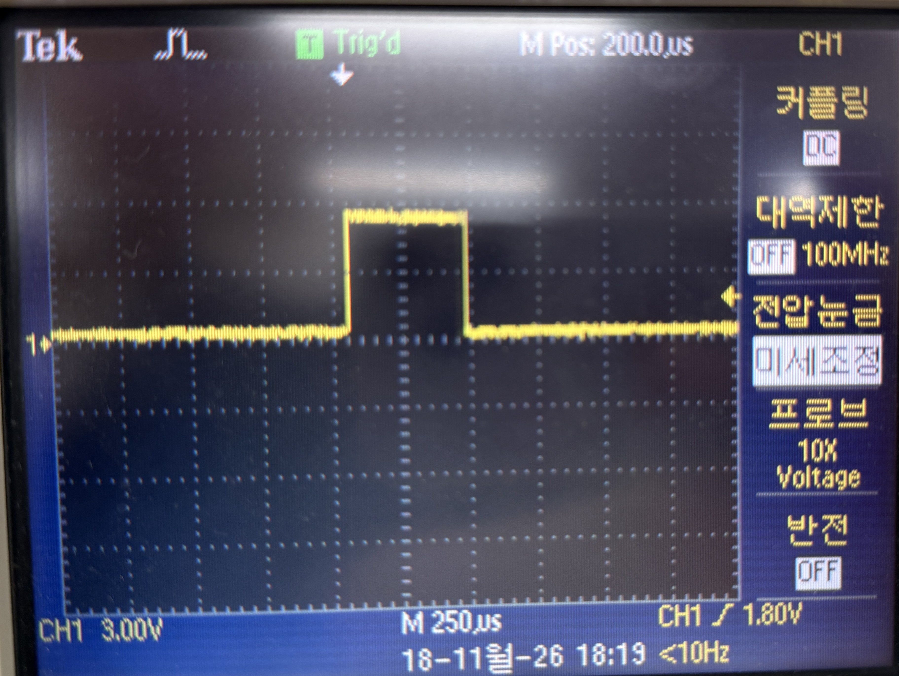 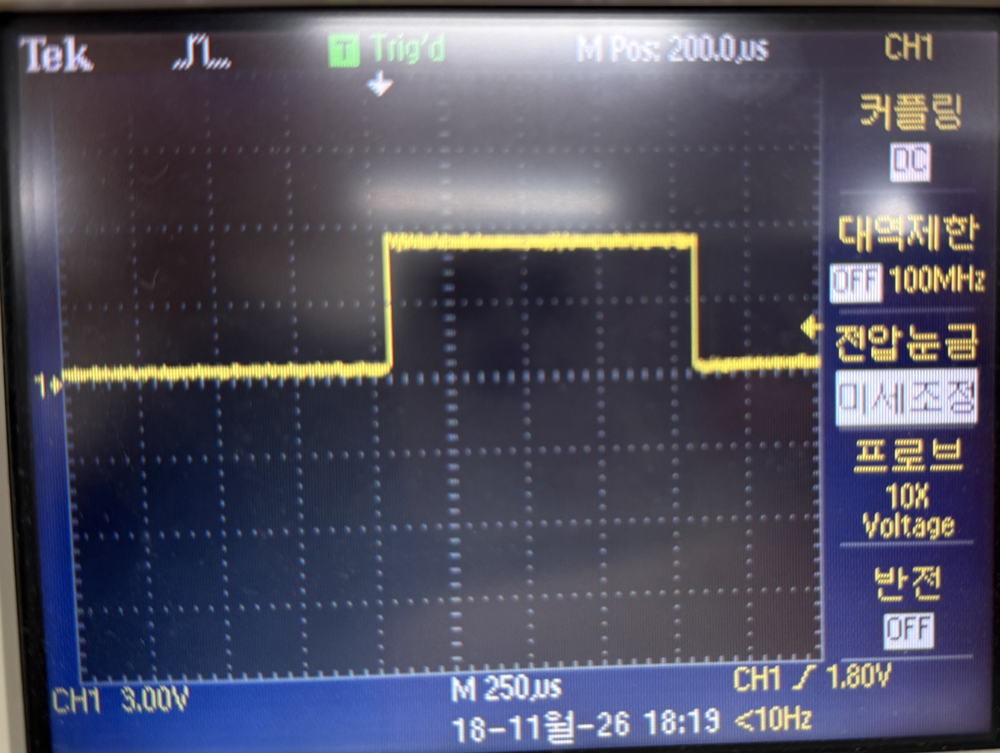 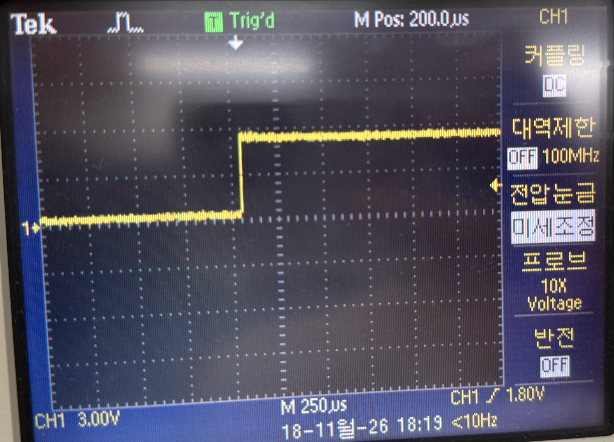

- 설정 : CH1 = ECHO, 3.00 V/div, 시간축 **250 µs/div**, 트리거 CH1 상승 에지

| 왼쪽 : 가까울 때 | 가운데 : 중간 | 오른쪽 : 멀 때 |
|---|---|---|
| HIGH 약 1.7칸 ≈ **0.43 ms** | HIGH 약 4.1칸 ≈ **1.0 ms** | HIGH 가 화면 밖까지 이어짐 → **1.4 ms 이상** |
| ≈ 7 cm | ≈ 18 cm | ≈ 24 cm 이상 |

- 거리(mm) ≈ 펄스 폭(µs) × 343 / 2000 → 폭은 화면 눈금으로 읽은 대략값
- 물체가 멀어질수록 ECHO HIGH 폭이 **옆으로 길어짐** (높이는 그대로)
- TRIG 는 거리와 상관없이 항상 10 µs 펄스 → 거리 정보는 **ECHO 에만** 있음

---

## 9. 실습 : STEP02 거리측정2 (TIM1 + 중앙값 + 디버그 출력)

8번(STEP02)을 **새 프로젝트(F411_LAB)** 에서 다시 구성한 버전. 타이머를 TIM1 으로 바꾸고, B1 버튼 인터럽트와 디버그 출력(`C,` 라인)을 추가

- 수업 자료 : [gotree94/STM32 STEP02_거리측정2 (NUCLEO-F411RE)](https://github.com/gotree94/STM32/blob/main/NUCLEO_F411RE/00.F411_TASK_LAB/STEP02_%EA%B1%B0%EB%A6%AC%EC%B8%A1%EC%A0%952.md)

### 9.1 8번과 달라진 점

| 항목 | 8번 (STEP02) | 9번 (STEP02 거리측정2) |
|---|---|---|
| 타이머 | TIM2 (32비트) | **TIM1** (16비트, 1 tick = 1 µs) |
| 펄스 폭 계산 | 32비트 뺄셈 | `(uint16_t)(fall - rise)` → 16비트 오버플로도 자동 처리 |
| EXTI 콜백 | PA0 만 처리 | PA0(ECHO) + **PC13(B1)** 를 `GPIO_Pin` 으로 분기 |
| 출력 | `D,` 라인만 | `D,` + **`C,` (ECHO 폭 TIM1 count)** 디버그 라인 |
| 부팅 배너 | 2줄 | TIM1 클럭 / 분주 / ARR 확인 줄 추가 |
| 거리 | 1개 | 기준값(343 m/s)과 보정값(`SetSoundSpeedX10`) 2개 계산 |

### 9.2 CubeMX 설정

| 핀 / 주변장치 | 설정 | 비고 |
|---|---|---|
| PA0 | GPIO_EXTI0, Label `ECHO`, **Rising/Falling** | 분압(1 kΩ / 2 kΩ) 후 연결 |
| PA1 | GPIO_Output, Label `TRIG` | |
| PC13 | GPIO_EXTI13, Label `B1`, Falling | 보드 파란 버튼 |
| PA5 | GPIO_Output, Label `LD2` | B1 누르면 토글 |
| PA2 / PA3 | USART2 TX / RX (115200) | printf 출력 |
| TIM1 | Internal Clock, Prescaler **84-1**, Period **65535** | 84 MHz / 84 = 1 MHz |
| NVIC | EXTI line0, EXTI line[15:10] Enable | |

### 9.3 배선

| HC-SR04 | 보드 쪽 |
|---|---|
| VCC | **5 V** |
| GND | GND |
| Trig | **A1 (PA1)** |
| Echo | 1 kΩ — **A0 (PA0)** — 2 kΩ — GND (분압) |

- ECHO 는 5 V 출력 → 분압으로 PA0 에 약 3.33 V 만 들어가게 함
- 센서와 보드 GND 는 반드시 공통

### 9.4 코드

`ultrasonic.c` 는 수업 자료 그대로 사용 (`Core/Src`), `ultrasonic.h` 는 `Core/Inc` 에 추가

#### 9.4.1 `ultrasonic.c` 핵심

```c
#define US_TIMER_TICKS_PER_US 1U
#define US_MIN_ECHO_TICKS (100U * US_TIMER_TICKS_PER_US)    // 100 µs
#define US_MAX_ECHO_TICKS (30000U * US_TIMER_TICKS_PER_US)  // 30 ms
#define US_REFERENCE_SOUND_SPEED_X10 3430U                  // 343.0 m/s
```

```c
void Ultrasonic_OnEchoEdge(void)     // EXTI 콜백에서 호출
{
  uint16_t now = US_GetCounter();    // TIM1->CNT

  if (HAL_GPIO_ReadPin(ECHO_GPIO_Port, ECHO_Pin) == GPIO_PIN_SET)
  {
    // Rising : 시작 count 저장
    s_echoStartCnt = now;
    s_echoRising = 1U;
  }
  else if (s_echoRising != 0U)
  {
    // Falling : 펄스 폭 = 끝 - 시작 (16비트 뺄셈 → 오버플로 처리)
    width = (uint16_t)(now - s_echoStartCnt);
    s_echoWidthTicks = width;
    s_echoDone = (width >= US_MIN_ECHO_TICKS && width <= US_MAX_ECHO_TICKS) ? 1U : 2U;
  }
}
```

```c
static void US_StoreSample(uint32_t width_ticks)
{
  uint32_t width_us = width_ticks / US_TIMER_TICKS_PER_US;
  uint32_t distance_ref_mm = (width_us * US_REFERENCE_SOUND_SPEED_X10) / 20000U;
  uint32_t distance_mm = (width_us * s_soundSpeedX10) / 20000U;
  ...
}
```

- `/20000` = (×0.1 → m/s) → mm/µs 환산 + 왕복이므로 ÷2
- 거리(mm) = 펄스 폭(µs) × 3430 / 20000

#### 9.4.2 `main.c`

```c
/* USER CODE BEGIN Includes */
#include <stdio.h>
#include "ultrasonic.h"
/* USER CODE END Includes */
```

```c
/* USER CODE BEGIN 0 */
#ifdef __GNUC__
#define PUTCHAR_PROTOTYPE int __io_putchar(int ch)
#else
#define PUTCHAR_PROTOTYPE int fputc(int ch, FILE *f)
#endif

PUTCHAR_PROTOTYPE
{
  if (ch == '\n')
  {
    HAL_UART_Transmit(&huart2, (uint8_t *)"\r", 1, 0xFFFF);
  }
  HAL_UART_Transmit(&huart2, (uint8_t *)&ch, 1, 0xFFFF);

  return ch;
}

static void Sensor_Task(void)
{
  Ultrasonic_Result result;
  char line[80];

  Ultrasonic_Task();

  if (Ultrasonic_GetResult(&result) != 0U)
  {
    (void)snprintf(line, sizeof(line), "D,%lu,%u,%u,%lu\n",
                   (unsigned long)result.timestamp_ms,
                   (unsigned int)result.distance_mm,
                   (unsigned int)result.valid,
                   (unsigned long)result.errors);
    printf("%s", line);
    printf("C,%u\n", (unsigned int)Ultrasonic_GetLastEchoTicks());
  }
}
/* USER CODE END 0 */
```

```c
  /* USER CODE BEGIN 2 */
  Ultrasonic_Init();
  printf("\n=== F411_TASK_LAB Step 2: Ultrasonic ===\n");
  printf("HC-SR04: TRIG=PA1, ECHO=PA0, 5 Hz sample, 1 Hz median\n");
  printf("TIM1: PCLK2=%luHz divider=%lu ARR=%lu tick=%luHz\n",
         (unsigned long)HAL_RCC_GetPCLK2Freq(),
         (unsigned long)(htim1.Init.Prescaler + 1U),
         (unsigned long)htim1.Init.Period,
         (unsigned long)(HAL_RCC_GetPCLK2Freq() / (htim1.Init.Prescaler + 1U)));
  /* USER CODE END 2 */

  /* Infinite loop */
  /* USER CODE BEGIN WHILE */
  while (1)
  {
    /* USER CODE END WHILE */

    /* USER CODE BEGIN 3 */
    Sensor_Task();
  }
  /* USER CODE END 3 */
}   // ← main() 닫는 중괄호. 지우면 안 됨 (9.6 참고)
```

```c
/* USER CODE BEGIN 4 */
void HAL_GPIO_EXTI_Callback(uint16_t GPIO_Pin)
{
  if (GPIO_Pin == ECHO_Pin)
  {
    Ultrasonic_OnEchoEdge();
  }
  else if (GPIO_Pin == B1_Pin)
  {
    HAL_GPIO_TogglePin(LD2_GPIO_Port, LD2_Pin);
  }
}
/* USER CODE END 4 */
```

- `HAL_GPIO_EXTI_Callback()` 은 모든 EXTI 가 공유 → 반드시 `GPIO_Pin` 으로 구분

#### 9.4.3 `stm32f4xx_it.c`

```c
void EXTI0_IRQHandler(void)
{
  /* USER CODE BEGIN EXTI0_IRQn 0 */

  /* USER CODE END EXTI0_IRQn 0 */
  HAL_GPIO_EXTI_IRQHandler(ECHO_Pin);
  /* USER CODE BEGIN EXTI0_IRQn 1 */

  /* USER CODE END EXTI0_IRQn 1 */
}

/* USER CODE BEGIN 1 */
void EXTI15_10_IRQHandler(void)
{
  HAL_GPIO_EXTI_IRQHandler(B1_Pin);
}
/* USER CODE END 1 */
```

- 흐름 : PA0 에지 → `EXTI0_IRQHandler` → `HAL_GPIO_EXTI_Callback` → `Ultrasonic_OnEchoEdge()`
- 흐름 : B1 누름 → `EXTI15_10_IRQHandler` → `HAL_GPIO_EXTI_Callback` → LD2 토글

### 9.5 출력 형식

부팅 배너

```text
=== F411_TASK_LAB Step 2: Ultrasonic ===
HC-SR04: TRIG=PA1, ECHO=PA0, 5 Hz sample, 1 Hz median
TIM1: PCLK2=84000000Hz divider=84 ARR=65535 tick=1000000Hz
```

1초마다 2줄

```text
D,t_ms,distance_mm,valid,errors
C,echo_ticks
```

| 행 | 의미 |
|---|---|
| `D` | 출력 시각(ms), 최근 5개 중앙값 거리(mm), 유효 여부, 누적 오류 수 |
| `C` | 마지막 ECHO 펄스의 TIM1 count 차이 (= µs). 검증용, 확인 끝나면 지워도 됨 |

- 검산 : `C` × 3430 / 20000 ≈ `D` 의 distance_mm

### 9.6 트러블슈팅 : 빌드 에러 (`main()` 닫는 중괄호 누락)

수업 자료의 `while` 코드 블록은 `/* USER CODE END 3 */` 에서 끝나고 **그 뒤의 `}` 가 빠져 있음**. 블록을 통째로 붙여넣으면서 CubeMX 가 만든 `main()` 의 닫는 `}` 까지 같이 지워져 빌드 에러 발생

```c
    /* USER CODE BEGIN 3 */
    Sensor_Task();
  }
  /* USER CODE END 3 */
}          // ← 이 줄이 없었음
```

- `}` 가 없으면 아래쪽 `SystemClock_Config()`, `MX_TIM1_Init()` 등이 전부 `main()` **안에** 정의된 것으로 해석됨 → main.c 컴파일 실패
- `}` 하나 추가 후 에러 / 경고 없이 빌드 완료

```text
   text	   data	    bss	    dec	    hex	filename
  17636	    104	   2128	  19868	   4d9c	F411_LAB.elf
```

> 코드 블록을 붙여넣을 때는 `USER CODE BEGIN/END` 주석 **바깥의 중괄호**가 지워지지 않았는지 확인
