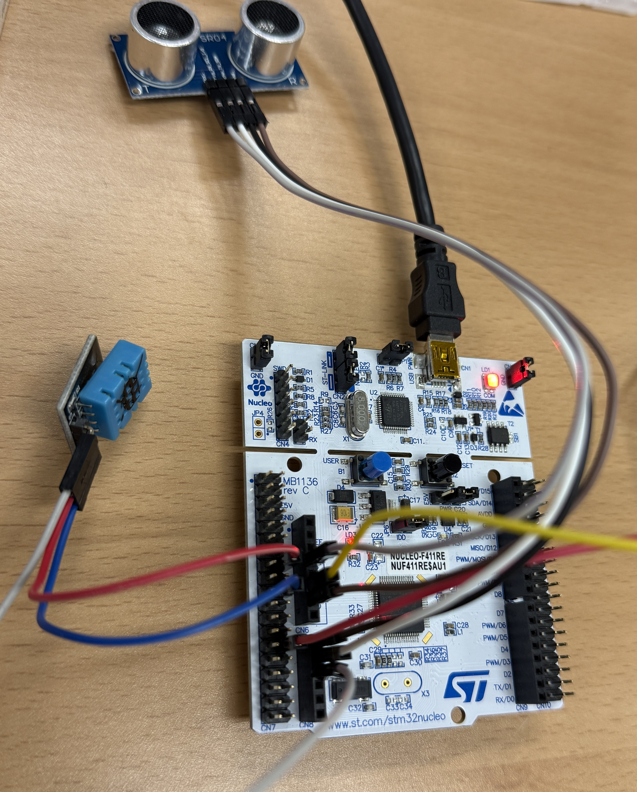

# 03. DHT11 (온습도 센서)

NUCLEO-F411RE 로 DHT11 온습도 센서 값을 읽어 UART 로 출력한 내용 정리

- 수업 자료 : [gotree94/STM32 12.DHT11 (NUCLEO-F411RE)](https://github.com/gotree94/STM32/blob/main/NUCLEO_F411RE/12.DHT11/DHT11.md)
- 프로젝트 : [yeooooly/F411_LAB](https://github.com/yeooooly/F411_LAB) (HC-SR04 STEP02 프로젝트에 이어서 작업)
  - 수업 자료는 DATA = **PA0** 기준 → 여기서는 PA0 / PA1 에 초음파가 연결되어 있어서 **PA4 (A2)** 사용

## Table of Contents
- [1. DHT11 센서](#1-dht11-센서)
- [2. 통신 방식](#2-통신-방식)
- [3. 배선](#3-배선)
- [4. CubeMX 설정](#4-cubemx-설정)
- [5. 수업 자료에서 바꾼 점](#5-수업-자료에서-바꾼-점)
- [6. 코드](#6-코드)
- [7. 결과](#7-결과)

---

## 1. DHT11 센서

| 항목 | 값 |
|---|---|
| 측정 | 온도 + 습도 |
| 온도 범위 / 정확도 | 0 ~ 50 °C / ±2 °C |
| 습도 범위 / 정확도 | 20 ~ 90 %RH / ±5 %RH |
| 전원 | 3.3 ~ 5 V |
| 통신 | **1-Wire 방식** (DATA 선 1개로 MCU ↔ 센서 양방향) |
| 측정 간격 | 최소 **2초** |

| 모듈 핀 | 의미 |
|---|---|
| **S** | Signal = DATA |
| **+** | VCC |
| **−** | GND |

- 모듈 기판에 풀업 저항이 있어서 별도 저항 없이 연결 가능 (코드에서도 내부 풀업 사용)

---

## 2. 통신 방식

DATA 선 하나를 MCU 와 센서가 번갈아 사용 → MCU 가 핀을 **출력 ↔ 입력** 으로 바꿔가며 통신

```text
MCU  : ──┐ 18 ms 이상 LOW ┌─ 20~40 µs HIGH ─→ (입력으로 전환)
         └────────────────┘
DHT11:                        ┌─ 80 µs ─┐
                     ─────────┘ 80 µs LOW └─ HIGH ─→ 데이터 40비트 시작
```

1. **시작 신호** : MCU 가 DATA 를 20 ms LOW → 30 µs HIGH 후 입력 모드로 전환
2. **응답** : DHT11 이 80 µs LOW → 80 µs HIGH
3. **데이터 40비트** : 비트마다 50 µs LOW 후 HIGH 가 이어짐

| 비트 | HIGH 길이 |
|---|---|
| 0 | 약 26 ~ 28 µs |
| 1 | 약 70 µs |

- 코드에서는 LOW 가 끝난 뒤 **30 µs 기다렸다가** 핀을 읽음 → HIGH 면 1, LOW 면 0
- 40비트 = 5바이트

| 바이트 | 내용 |
|---|---|
| 0 | 습도 정수 |
| 1 | 습도 소수 |
| 2 | 온도 정수 |
| 3 | 온도 소수 |
| 4 | 체크섬 = 0 + 1 + 2 + 3 바이트 합 (하위 8비트) |

---

## 3. 배선



- 왼쪽 : DHT11 모듈, 위쪽 : HC-SR04 (STEP02 에서 쓰던 그대로 꽂아 둠)
- 두 센서 모두 보드 왼쪽 Arduino 헤더 **CN6 (전원)** / **CN8 (A0 ~ A5)** 에 연결

### 3.1 DHT11

| DHT11 핀 | 선 색 | 보드 헤더 | MCU 핀 | 코드 |
|---|---|---|---|---|
| **S** (DATA) | 흰색 | CN8 **A2** | **PA4** | `#define DHT11_PORT GPIOA` / `#define DHT11_PIN GPIO_PIN_4` |
| **+** (VCC) | 빨간색 | CN6 **3V3** | - | - |
| **−** (GND) | 파란색 | CN6 **GND** | - | - |

- `DHT11_SetPinOutput()` / `DHT11_SetPinInput()` 이 PA4 하나를 출력 ↔ 입력으로 바꿔가며 통신
- 입력일 때 내부 풀업 (`GPIO_PULLUP`) + 모듈 풀업 → 선이 놓여 있으면 HIGH

### 3.2 HC-SR04 (연결만 유지, 이번 코드에서는 사용 안 함)

| HC-SR04 핀 | 보드 헤더 | MCU 핀 | 이번 코드 |
|---|---|---|---|
| Echo | CN8 **A0** | PA0 | `HAL_NVIC_DisableIRQ(EXTI0_IRQn)` 로 인터럽트 끔 |
| Trig | CN8 **A1** | PA1 | 출력 LOW 유지 (CubeMX 초기값) |
| VCC / GND | CN6 5V / GND | - | - |

- DHT11 을 A0 대신 **A2** 에 꽂아서 초음파 선을 뽑지 않고 같이 둘 수 있음

### 3.3 Arduino 헤더 ↔ MCU 핀

| CN8 | A0 | A1 | **A2** | A3 | A4 | A5 |
|---|---|---|---|---|---|---|
| MCU | PA0 | PA1 | **PA4** | PB0 | PC1 | PC0 |
| 연결 | ECHO | TRIG | **DHT11 S** | - | - | - |

---

## 4. CubeMX 설정

| 핀 / 주변장치 | 설정 | 비고 |
|---|---|---|
| PA4 | GPIO_Output | DHT11 DATA (코드에서 출력 ↔ 입력 전환) |
| TIM1 | Prescaler 84-1, Period 65535 | 84 MHz / 84 = **1 MHz** → 1 tick = 1 µs (µs 딜레이용) |
| USART2 | 115200 baud | printf / 결과 출력 |

- HC-SR04 실습에서 쓰던 TIM1 을 그대로 µs 타이머로 사용

---

## 5. 수업 자료에서 바꾼 점

| 항목 | 수업 자료 | 이번 코드 | 이유 |
|---|---|---|---|
| DATA 핀 | `GPIO_PIN_0` (PA0) | **`GPIO_PIN_4` (PA4, A2)** | PA0 / PA1 은 초음파 ECHO / TRIG 로 사용 중 |
| µs 타이머 | `htim2` | **`htim1`** | 이 프로젝트는 TIM1 이 1 MHz 로 설정되어 있음 |
| PA0 인터럽트 | - | `HAL_NVIC_DisableIRQ(EXTI0_IRQn)` | 초음파 ECHO 인터럽트가 DHT11 µs 타이밍을 방해하지 않게 끔 |
| EXTI 콜백 | - | B1 버튼 (LD2 토글) 만 남김 | 초음파 함수는 이번에 사용 안 함 |
| 대기 루프 | `while (... && timeout--)` | **`while (... && --timeout)`** | 타임아웃이 나면 `timeout` 이 정확히 0 이 되어 `if (timeout == 0)` 검사가 동작 |
| 비트 타임아웃 | - | `dht11_bit_timeout` 플래그 | 비트를 읽다 타임아웃이 나면 실패 처리 (0 값이 체크섬을 통과하는 것 방지) |

---

## 6. 코드

`main.c` 의 `USER CODE` 영역만 수정

```c
/* USER CODE BEGIN Includes */
#include <stdio.h>
#include <string.h>
#include "ultrasonic.h"


/* USER CODE END Includes */
```

```c
/* USER CODE BEGIN PTD */
typedef struct {
    uint8_t temperature;
    uint8_t humidity;
    uint8_t temp_decimal;
    uint8_t hum_decimal;
    uint8_t checksum;
} DHT11_Data;
/* USER CODE END PTD */
```

```c
/* USER CODE BEGIN PD */
#define DHT11_PORT GPIOA
#define DHT11_PIN GPIO_PIN_4   // A2 = PA4 (A0 = ECHO, A1 = TRIG)
/* USER CODE END PD */
```

```c
/* USER CODE BEGIN PV */
DHT11_Data dht11_data;
char uart_buffer[100];  // uart_buffer 변수 선언 추가
uint8_t dht11_bit_timeout;  // 비트 읽는 중 타임아웃 발생 여부
/* USER CODE END PV */
```

```c
/* USER CODE BEGIN PFP */
void DHT11_SetPinOutput(void);
void DHT11_SetPinInput(void);
void DHT11_SetPin(GPIO_PinState state);
GPIO_PinState DHT11_ReadPin(void);
void DHT11_DelayUs(uint32_t us);
uint8_t DHT11_Start(void);
uint8_t DHT11_ReadBit(void);
uint8_t DHT11_ReadByte(void);
uint8_t DHT11_ReadData(DHT11_Data *data);
/* USER CODE END PFP */
```

```c
/* USER CODE BEGIN 0 */
#ifdef __GNUC__
#define PUTCHAR_PROTOTYPE int __io_putchar(int ch)
#else
#define PUTCHAR_PROTOTYPE int fputc(int ch, FILE *f)
#endif /* __GNUC__ */

PUTCHAR_PROTOTYPE
{
  if (ch == '\n')
    HAL_UART_Transmit (&huart2, (uint8_t*) "\r", 1, 0xFFFF);
  HAL_UART_Transmit (&huart2, (uint8_t*) &ch, 1, 0xFFFF);
  return ch;
}

// DHT11 함수 구현 (수정된 버전)
void DHT11_SetPinOutput(void) {
    GPIO_InitTypeDef GPIO_InitStruct = {0};
    GPIO_InitStruct.Pin = DHT11_PIN;
    GPIO_InitStruct.Mode = GPIO_MODE_OUTPUT_PP;
    GPIO_InitStruct.Pull = GPIO_NOPULL;
    GPIO_InitStruct.Speed = GPIO_SPEED_FREQ_HIGH;
    HAL_GPIO_Init(DHT11_PORT, &GPIO_InitStruct);
}

void DHT11_SetPinInput(void) {
    GPIO_InitTypeDef GPIO_InitStruct = {0};
    GPIO_InitStruct.Pin = DHT11_PIN;
    GPIO_InitStruct.Mode = GPIO_MODE_INPUT;
    GPIO_InitStruct.Pull = GPIO_PULLUP;  // 내부 풀업 저항 사용
    HAL_GPIO_Init(DHT11_PORT, &GPIO_InitStruct);
}

void DHT11_SetPin(GPIO_PinState state) {
    HAL_GPIO_WritePin(DHT11_PORT, DHT11_PIN, state);
}

GPIO_PinState DHT11_ReadPin(void) {
    return HAL_GPIO_ReadPin(DHT11_PORT, DHT11_PIN);
}

void DHT11_DelayUs(uint32_t us) {
    __HAL_TIM_SET_COUNTER(&htim1, 0);   // TIM1 : 1 tick = 1 us
    while (__HAL_TIM_GET_COUNTER(&htim1) < us);
}

// 수정된 DHT11_Start() 함수
uint8_t DHT11_Start(void) {
    uint32_t timeout;

    // 1. 출력 모드로 설정하고 HIGH로 초기화
    DHT11_SetPinOutput();
    DHT11_SetPin(GPIO_PIN_SET);
    HAL_Delay(1);  // 안정화 시간

    // 2. 시작 신호 전송 (최소 18ms LOW)
    DHT11_SetPin(GPIO_PIN_RESET);
    HAL_Delay(20);  // 20ms LOW

    // 3. 20-40us HIGH 신호
    DHT11_SetPin(GPIO_PIN_SET);
    DHT11_DelayUs(30);

    // 4. 입력 모드로 변경
    DHT11_SetPinInput();

    // 5. DHT11 응답 대기 (80us LOW)
    timeout = 1000;  // 타임아웃 증가
    while (DHT11_ReadPin() && --timeout) {
        DHT11_DelayUs(1);
    }
    if (timeout == 0) {
        sprintf(uart_buffer, "DHT11 Start: No LOW response\r\n");
        HAL_UART_Transmit(&huart2, (uint8_t*)uart_buffer, strlen(uart_buffer), HAL_MAX_DELAY);
        return 0;
    }

    // 6. 80us HIGH 대기
    timeout = 1000;
    while (!(DHT11_ReadPin()) && --timeout) {
        DHT11_DelayUs(1);
    }
    if (timeout == 0) {
        sprintf(uart_buffer, "DHT11 Start: No HIGH response\r\n");
        HAL_UART_Transmit(&huart2, (uint8_t*)uart_buffer, strlen(uart_buffer), HAL_MAX_DELAY);
        return 0;
    }

    // 7. HIGH가 끝날 때까지 대기
    timeout = 1000;
    while (DHT11_ReadPin() && --timeout) {
        DHT11_DelayUs(1);
    }

    return 1;  // 성공
}

// 수정된 DHT11_ReadBit() 함수
uint8_t DHT11_ReadBit(void) {
    uint32_t timeout;

    // 1. LOW 신호가 끝날 때까지 대기 (약 50us)
    timeout = 1000;
    while (!(DHT11_ReadPin()) && --timeout) {
        DHT11_DelayUs(1);
    }
    if (timeout == 0) {
        dht11_bit_timeout = 1;  // LOW 가 끝나지 않음 → 선이 LOW 에 붙어 있음
        return 0;
    }

    // 2. HIGH 신호 지속 시간 측정
    DHT11_DelayUs(30);  // 30us 후에 확인
    uint8_t bit = DHT11_ReadPin();

    // 3. HIGH가 끝날 때까지 대기
    timeout = 1000;
    while (DHT11_ReadPin() && --timeout) {
        DHT11_DelayUs(1);
    }

    return bit;
}

uint8_t DHT11_ReadByte(void) {
    uint8_t byte = 0;
    for (int i = 0; i < 8; i++) {
        byte = (byte << 1) | DHT11_ReadBit();
    }
    return byte;
}

uint8_t DHT11_ReadData(DHT11_Data *data) {
    // DHT11 시작 신호 전송
    if (!DHT11_Start()) {
        return 0; // 시작 신호 실패
    }

    // 5바이트 데이터 읽기
    dht11_bit_timeout = 0;
    data->humidity = DHT11_ReadByte();
    data->hum_decimal = DHT11_ReadByte();
    data->temperature = DHT11_ReadByte();
    data->temp_decimal = DHT11_ReadByte();
    data->checksum = DHT11_ReadByte();

    // 디버그 출력
    sprintf(uart_buffer, "Raw data: %d, %d, %d, %d, %d\r\n",
            data->humidity, data->hum_decimal, data->temperature, data->temp_decimal, data->checksum);
    HAL_UART_Transmit(&huart2, (uint8_t*)uart_buffer, strlen(uart_buffer), HAL_MAX_DELAY);

    // 비트 타임아웃이 있었으면 0 이 체크섬을 통과해도 실패 처리
    if (dht11_bit_timeout) {
        sprintf(uart_buffer, "DHT11 Bit timeout: DATA line stuck LOW\r\n");
        HAL_UART_Transmit(&huart2, (uint8_t*)uart_buffer, strlen(uart_buffer), HAL_MAX_DELAY);
        return 0;
    }

    // 체크섬 확인
    uint8_t calculated_checksum = data->humidity + data->hum_decimal +
                                 data->temperature + data->temp_decimal;

    if (calculated_checksum == data->checksum) {
        return 1; // 성공
    } else {
        sprintf(uart_buffer, "Checksum error: calc=%d, recv=%d\r\n",
                calculated_checksum, data->checksum);
        HAL_UART_Transmit(&huart2, (uint8_t*)uart_buffer, strlen(uart_buffer), HAL_MAX_DELAY);
        return 0; // 체크섬 오류
    }
}
/* USER CODE END 0 */
```

```c
  /* USER CODE BEGIN 2 */
  // PA0(A0) = 초음파 ECHO 인터럽트(EXTI0) → 이번엔 초음파를 쓰지 않으므로 DHT11 타이밍을 방해하지 않게 끔
  HAL_NVIC_DisableIRQ(EXTI0_IRQn);

  // DHT11 핀 초기 설정
  DHT11_SetPinOutput();
  DHT11_SetPin(GPIO_PIN_SET);  // 초기에 HIGH로 설정
  HAL_Delay(1000);  // DHT11 안정화 시간


  // 타이머 시작 (마이크로초 단위 지연용)
  HAL_TIM_Base_Start(&htim1);

  // UART 초기화 메시지
  sprintf(uart_buffer, "DHT11 Temperature & Humidity Sensor Test\r\n");
  HAL_UART_Transmit(&huart2, (uint8_t*)uart_buffer, strlen(uart_buffer), HAL_MAX_DELAY);

  /* USER CODE END 2 */
```

```c
  while (1)
  {
    /* USER CODE END WHILE */

    /* USER CODE BEGIN 3 */
    if (DHT11_ReadData(&dht11_data)) {
      // 데이터 읽기 성공
      sprintf(uart_buffer, "Temperature: %d°C, Humidity: %d%%\r\n",
              dht11_data.temperature, dht11_data.humidity);
      HAL_UART_Transmit(&huart2, (uint8_t*)uart_buffer, strlen(uart_buffer), HAL_MAX_DELAY);
    } else {
      // 데이터 읽기 실패
      sprintf(uart_buffer, "DHT11 Read Error!\r\n");
      HAL_UART_Transmit(&huart2, (uint8_t*)uart_buffer, strlen(uart_buffer), HAL_MAX_DELAY);
    }

    // 2초 대기 (DHT11은 최소 2초 간격으로 읽어야 함)
    HAL_Delay(2000);
  }
  /* USER CODE END 3 */
```

```c
/* USER CODE BEGIN 4 */
void HAL_GPIO_EXTI_Callback(uint16_t GPIO_Pin)
{
  if (GPIO_Pin == B1_Pin)
  {
    HAL_GPIO_TogglePin(LD2_GPIO_Port, LD2_Pin);
  }
}
/* USER CODE END 4 */
```

---

## 7. 결과

### 7.1 시리얼 출력 (115200 baud)

```text
DHT11 Temperature & Humidity Sensor Test
Raw data: 36, 0, 27, 3, 66
Temperature: 27°C, Humidity: 36%
```

- 2초마다 `Raw data` / `Temperature` 2줄 반복

### 7.2 Raw data 해석

| 바이트 | 값 | 의미 |
|---|---:|---|
| 습도 정수 | 36 | **36 %RH** |
| 습도 소수 | 0 | DHT11 은 습도 소수 0 |
| 온도 정수 | 27 | **27 °C** |
| 온도 소수 | 3 | 0.3 °C → 실제 **27.3 °C** |
| 체크섬 | 66 | 36 + 0 + 27 + 3 = **66** → 일치 |

- 체크섬이 일치 → 40비트를 오류 없이 수신
- 출력은 정수만 표시 (`%d`) → 소수까지 보려면 `temp_decimal` 을 같이 출력
