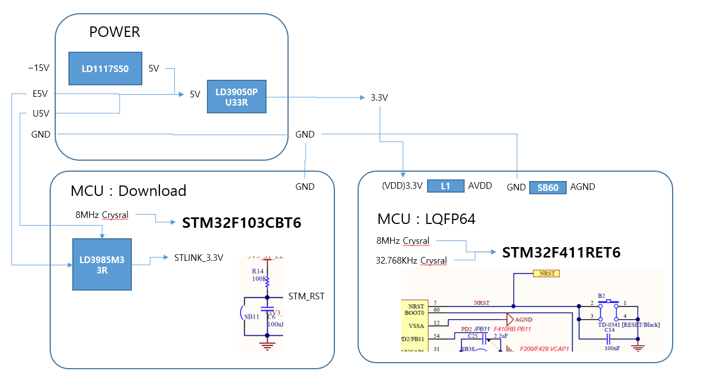
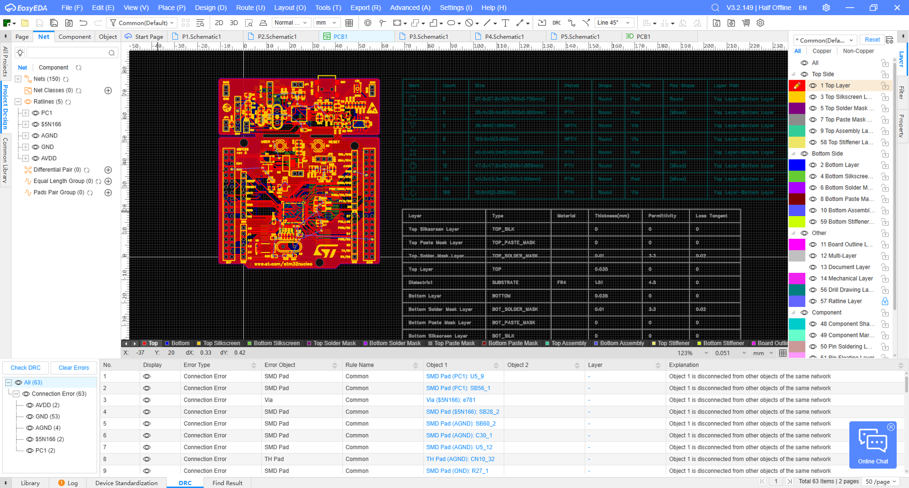
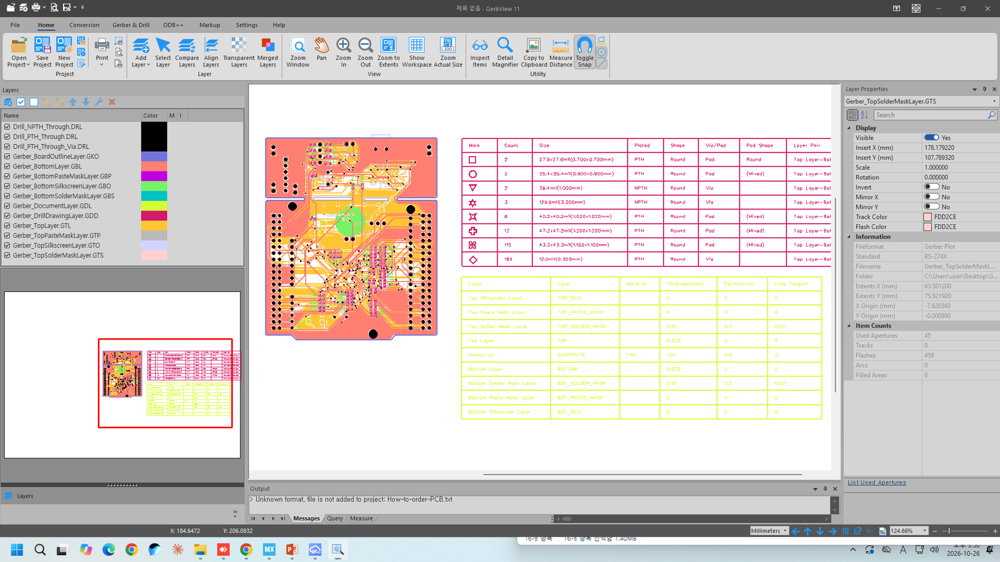
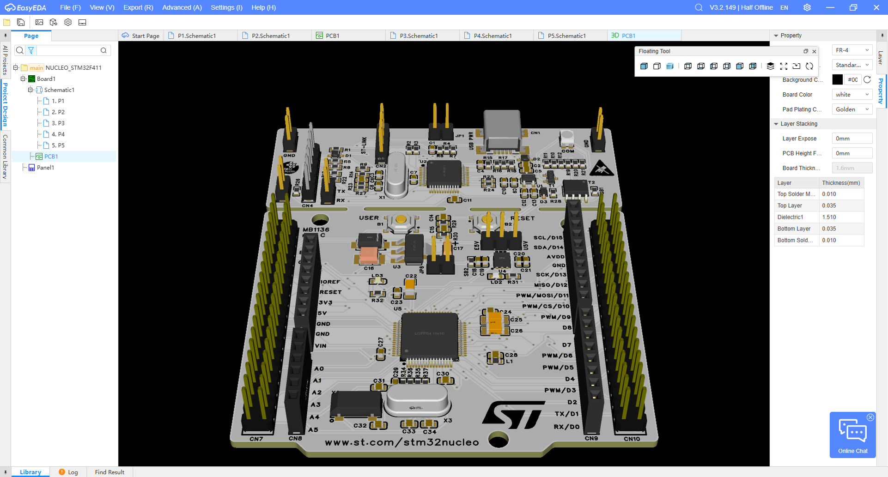
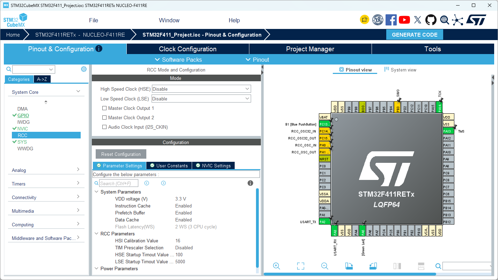
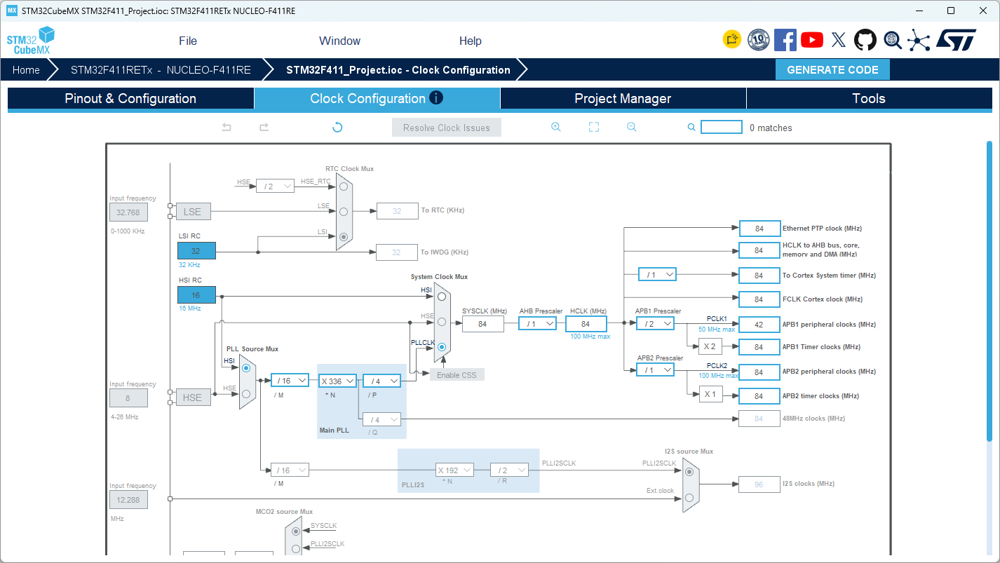
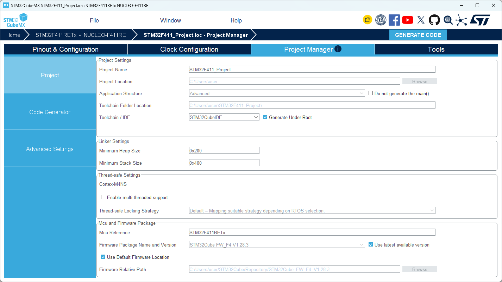

# STM32F411_Project

---

## Hardware

 <br>
 <br>
 <br>
 <br>

## Firmware

* RCC : Disable



* CLOCK



* 프로젝트 생성



```c
  /* Infinite loop */
  /* USER CODE BEGIN WHILE */
  while (1)
  {
    /* USER CODE END WHILE */

    /* USER CODE BEGIN 3 */
  }
  /* USER CODE END 3 */
}
```
